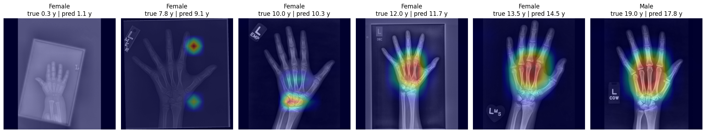
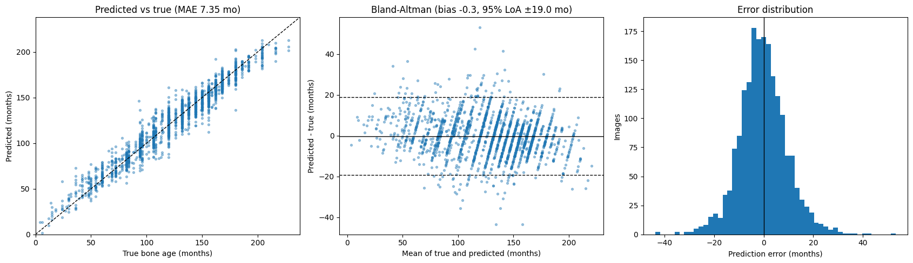
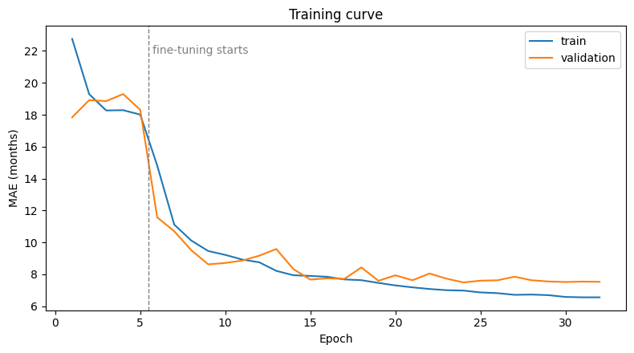
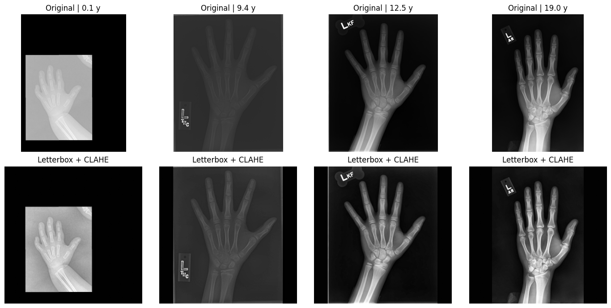

# Bone Age Prediction from Hand X-rays

[](https://colab.research.google.com/github/vahid-karami/bone-age-prediction/blob/main/bone_age_prediction.ipynb)


A deep learning model that estimates **skeletal bone age (in months)** from a pediatric left-hand radiograph and the patient's sex.
It was trained and evaluated on the public **RSNA Pediatric Bone Age** dataset (12,611 images).

**Test MAE: 7.35 months (95% CI 7.07–7.63) · R² = 0.944 · 82% of predictions within ±1 year**

<p align="center"></p>

## Why it matters

Bone age assessment is a routine pediatric radiology exam used to diagnose growth disorders, endocrine conditions and
precocious or delayed puberty. Radiologists usually compare the X-ray against the Greulich-Pyle atlas. This is slow, and
readings can differ by several months between radiologists. An automated estimate can serve as a fast, consistent second reader.

## Results

Held-out test set: 1,892 images (15% of the data), never used for training or model selection.

| Metric | Value |
|---|---|
| **MAE** | **7.35 months** (95% bootstrap CI 7.07–7.63) |
| Median absolute error | 5.78 months |
| RMSE | 9.71 months |
| R² | 0.944 |
| Predictions within ±12 months | 82.2% |
| Mean bias (Bland-Altman) | −0.3 months (95% limits of agreement ±19.0) |
| Baseline MAE (always predict the mean age) | 33.43 months |

| Subgroup | Test images | MAE (months) |
|---|---|---|
| Female | 867 | 7.79 |
| Male | 1,025 | 6.97 |
| 0-5 years | 126 | 8.84 |
| 5-10 years | 514 | 8.08 |
| 10-15 years | 1,091 | 6.79 |
| 15-19 years | 161 | 7.58 |

<p align="center"></p>

**What the results show**
- The model is **unbiased across the age range**: the mean error is −0.3 months, and the Bland-Altman plot shows no trend with age.
- Error is lowest for ages 10-15, where most of the training data is, and highest for under-5s, which are under-represented (7% of images).
  The model is slightly less accurate for girls than for boys (7.8 vs 7.0 months).
- **Grad-CAM:** in most test images the model attends to the **carpal bones, metacarpals and phalanges**, the regions radiologists use.
  In some images, attention falls partly on the background or on markers outside the hand (for example the 7.8-year-old above), a sign of shortcut learning.
  Cropping the hand before training is a planned fix.

<p align="center"></p>

## Method

| Step | Details |
|---|---|
| Data | RSNA Pediatric Bone Age Challenge (2017): 12,611 radiographs, ages 0-19, one image per patient |
| Split | 70 / 15 / 15 train / validation / test, stratified by sex and bone-age decile (patient-level by construction) |
| Preprocessing | Aspect-ratio-preserving resize to 320 px, zero padding to a square, CLAHE contrast enhancement |
| Augmentation | Random rotation (±18°), shift, zoom, contrast and horizontal flip (training only, on GPU) |
| Model | Xception (ImageNet-pretrained) + sex branch (Dense 32), concatenated, then Dense 256 and a regression output rescaled to months |
| Training | Phase 1: frozen backbone, Adam 1e-3. Phase 2: full fine-tuning, Adam 1e-4, ReduceLROnPlateau, early stopping, MAE loss, mixed precision |
| Evaluation | MAE with 2,000-sample bootstrap 95% CI, RMSE, R², subgroup MAE by sex and age, Bland-Altman analysis |
| Explainability | Grad-CAM on the last Xception block |

<p align="center"></p>

## Run it

The easiest way is to click **Open in Colab** above, choose a **T4 GPU** runtime and run all cells.
The dataset downloads automatically through `kagglehub`, and no API key is needed.
A full run takes about 2 hours on a free Colab T4: about 15 minutes for the download and preprocessing, then about 3.5 minutes per fine-tuning epoch.

To run it locally:

```bash
pip install -r requirements.txt
jupyter notebook bone_age_prediction.ipynb
```

## Repository structure

```
bone_age_prediction.ipynb   end-to-end notebook: data, preprocessing, training, evaluation, Grad-CAM
results/                    figures and metrics.json from the reported run
requirements.txt
```

## Project history

The first version of this project (2023) reached a training MAE of about 1.6 months but a validation MAE of 8-10 months.
This rewrite fixes the problems found in that version:

- **Evaluation bug:** test predictions were made with a shuffled generator, so they were compared with the wrong labels.
  Test data is now never shuffled, and predictions are joined by order.
- **Unreliable validation:** only one batch (32 images) was used for validation. The full validation set is now used every epoch.
- **Overfitting:** there was no augmentation and the patient's sex was not used. Both have been added, together with dropout and two-phase fine-tuning.
- **Callbacks not applied:** early stopping, the LR schedule and checkpointing were defined but never passed to `fit`.
- **Reproducibility:** the model is now built in the notebook rather than loaded from a private Drive file. The split is saved, seeds are fixed, and the original images are no longer overwritten in place.
- **Clinical-style evaluation:** confidence intervals, subgroup analysis, Bland-Altman analysis and Grad-CAM have been added.

## Limitations

- Single-source dataset with no external validation on other hospitals or scanners.
- The ground truth is itself a radiologist reading, with inter-observer variability.
- The 320 px input is lower than in challenge-winning solutions (MAE about 4.2 months with higher resolution and ensembles).
- This is a research and portfolio project, **not a medical device**, and it is not intended for clinical use.

## Next steps

- Crop the hand region before training, to remove background and markers and reduce shortcut learning.
- Increase the input resolution (448-512 px) and ensemble several models.
- Port the model to **PyTorch / MONAI**.

## Author

**Vahid Karami**: biomedical engineer, medical imaging and ML

## Acknowledgements

Dataset: Halabi SS et al., *The RSNA Pediatric Bone Age Machine Learning Challenge*, Radiology 2019;290(2):498-503.
The dataset is redistributed on Kaggle by [kmader](https://www.kaggle.com/datasets/kmader/rsna-bone-age).
